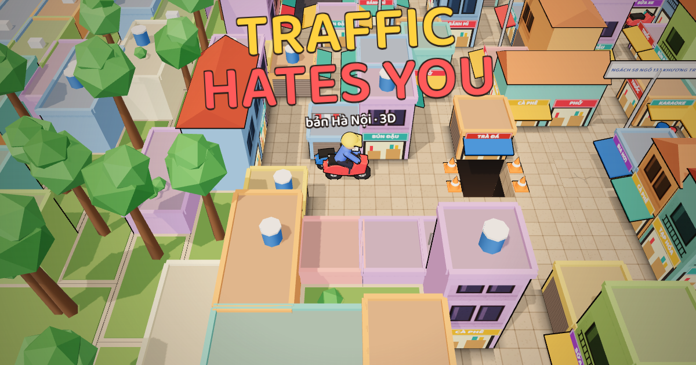

# Traffic Hates You – bản Hà Nội 3D

Game troll-platformer 3D góc nhìn cao 3/4 cố định (học theo Trees Hate You): chạy xe máy tới công ty trước 8:00 qua 4 chương. Mỗi chương là **một bản đồ lớn liền mạch**: các khu phố Hà Nội (ngõ, ngã tư, chợ, công viên, công trình, Bờ Hồ...) nối với nhau bằng ngõ nhỏ, cuối mỗi khu có **cổng checkpoint**, chết thì quay lại checkpoint gần nhất. Bạn tự do chạy 8 hướng và nhảy. Thứ gì trên đường cũng ghét bạn: ổ gà tàng hình, đèn đỏ troll, cột điện đổ, chó không xích, bà cụ qua đường, xe buýt, ô tô mở cửa, đinh tặc, cục nóng điều hòa rơi, cây đổ, phố ngập thành sông, cổng công ty tự đóng... Chết là chuyện bình thường, mỗi lần chết đồng hồ chạy thêm 1 phút.



## Nội dung

- **4 chương, mỗi chương một bản đồ lớn** gồm 3–4 khu (15 khu tất cả): Ngõ Nhỏ (bình minh, Thanh Xuân) · Đường Lớn (ban ngày, Ngã Tư Sở) · Mưa Hà Nội (mưa, đường trơn, Công viên Thống Nhất) · Tới Công Ty (Hoàn Kiếm, văn phòng ngay Bờ Hồ, có Tháp Rùa; phóng xuống Hồ Gươm là chết).
- **Checkpoint**: về đích một khu là cổng sang ngõ kế tiếp mở ra; chết thì hồi sinh ngay sau cổng gần nhất.
- **Ngõ nối giữa các khu đầy bẫy ngẫu nhiên, không báo trước**: ổ gà tàng hình, cây đổ cực nhanh, cục nóng/chậu cây rơi, xe máy ninja lao từ sau lưng. Mỗi lần chết bẫy được xếp lại.
- **20 loại bẫy**, mỗi màn có 3–6 bẫy, chơi kiểu "chết một lần là nhớ".
- Đồ họa 3D kiểu hoạt hình (toon shading, viền đen), phố nhà ống, biển hiệu kiểu Hà Nội (bún chả, bia hơi, photocopy...), dây điện, mưa, nước ngập, Hồ Gươm.
- Giọng Bắc: "ngõ" chứ không "hẻm", "rẽ" chứ không "quẹo", "điều hòa", "muộn làm", mẹ dặn mua xôi xéo, chậu quất rơi, xe buýt 32.
- Muốn phố **thật như bản đồ**: có sẵn `npm run osm` để lấy đường phố thật từ OpenStreetMap thành bản đồ ô (xem mục "Bản đồ từ phố thật").
- Nhạc nền ngũ cung và hiệu ứng âm thanh đều được tổng hợp bằng Web Audio, không cần file âm thanh.
- Lưu tiến trình (màn đã mở, số lần chết ít nhất mỗi màn, kỷ lục cả lượt).
- Chơi được bằng bàn phím, cảm ứng (điện thoại, máy tính bảng) và tay cầm.
- Cài được như app (PWA) và chơi offline.
- Hai ngôn ngữ: tiếng Việt và tiếng Anh, tự chọn theo trình duyệt (máy tiếng Việt thì tiếng Việt, còn lại tiếng Anh), đổi được trong Cài đặt.
- Cài đặt: ngôn ngữ, nhạc, âm thanh, rung, chất lượng đồ họa (Tự động/Cao/Vừa/Thấp), toàn màn hình, xóa tiến trình.

## Điều khiển

| Hành động | Bàn phím | Cảm ứng | Tay cầm |
|---|---|---|---|
| Chạy 8 hướng | ← ↑ → ↓ / W A S D | kéo cần gạt (càng kéo xa càng nhanh) | cần trái / D-pad |
| Nhảy | Space (hoặc J, K) | nút ⤒ bên phải | A |
| Chơi lại từ checkpoint | R | menu tạm dừng | |
| Tạm dừng | Esc / P | ❚❚ | Start |

## Chạy trên máy

Cần Node.js 20 trở lên.

```bash
npm install
npm run dev        # mở http://localhost:5173/game.html
npm test           # bot tự chơi 15 khu + chạy qua mọi ngõ với 20 lần xếp bẫy ngẫu nhiên + thử công cụ nhập OpenStreetMap
npm run build      # build vào dist/ và chép bản build ra thư mục gốc repo
npm run preview    # chạy thử bản build
```

## Phát hành

`npm run build` tạo thư mục `dist/` gồm toàn file tĩnh (HTML, JS, font, icon) và chép luôn ra thư mục gốc repo (`index.html`, `assets/`, `icons/`, `sw.js`...). Bản build dùng đường dẫn tương đối nên đặt ở thư mục nào cũng chạy. Mã nguồn trang nằm ở `game.html`; đừng sửa tay `index.html` ở gốc vì nó là file build.

### GitHub Pages (tự động)

Repo đang để Pages ở chế độ **Deploy from a branch** (`main` / root). Workflow `.github/workflows/deploy.yml` chạy mỗi lần push lên `main`: test, build rồi commit bản build vào thư mục gốc ("Update built game"); Pages tự đăng commit đó.

Link game: `https://betuanminh22032003.github.io/traffic-hates-you/`.

### itch.io

1. `npm run build`
2. Nén **nội dung** thư mục `dist` (không nén cả thư mục): `cd dist && zip -r ../traffic-hates-you.zip .`
3. Trên itch.io: Create new project → Kind of project: **HTML** → upload file zip → tick **This file will be played in the browser**.
4. Gợi ý cài đặt khung game: 1280 × 720, bật **Mobile friendly** (orientation: Landscape) và **Fullscreen button**.

### Netlify / Vercel / Cloudflare Pages

Kết nối repo, build command `npm run build`, publish directory `dist`. Không cần cấu hình thêm.

### Lên điện thoại như app

- Mở link game trên điện thoại → menu trình duyệt → **Thêm vào màn hình chính**. Game chạy toàn màn hình, nằm ngang, chơi được offline.
- Muốn lên Google Play: đóng gói PWA bằng [Bubblewrap](https://github.com/GoogleChromeLabs/bubblewrap) hoặc [PWABuilder](https://www.pwabuilder.com/) từ link đã đăng (cần HTTPS).

### Trước khi phát hành, kiểm tra

- [ ] `npm test` báo `Every chapter map is sealed by its checkpoints and every alley is passable.` và `OSM import works on the sample block.` (và các khu đều `ok`).
- [ ] `npm run build` không lỗi, `npm run preview` chơi thử được chương 1; tắt mạng rồi tải lại trang vẫn chơi được.
- [ ] Đổi link/ảnh chia sẻ nếu đăng ở chỗ khác GitHub Pages: thẻ `og:url`, `og:image` trong `game.html` phải là link tuyệt đối; ảnh ở `public/icons/og.png` (1200 × 630).
- [ ] Đổi phiên bản trong `package.json` và chữ `v3.2` ở màn hình tiêu đề (`game.html`).
- [ ] Không cần đổi tên cache: mỗi lần build, `sw.js` tự nhận mã phiên bản mới và danh sách file cần lưu offline.
- [ ] Đổi cấu trúc màn/chương thì tăng khóa lưu trong `src/save.js` (`traffic-hates-you:v2` → `v3`) để save cũ không trỏ sai chỗ.

## Thiết kế

Tài liệu thiết kế sản phẩm (vấn đề, nguyên tắc troll, cơ chế, danh sách màn): [`docs/DESIGN.md`](docs/DESIGN.md). Kế hoạch phát hành (nền tảng, lịch, pháp lý): [`docs/RELEASE-PLAN.md`](docs/RELEASE-PLAN.md).

## Cấu trúc mã

```
game.html               khung trang + các màn hình menu (mã nguồn; index.html ở gốc là bản build)
src/main.js             vòng lặp game, luồng màn chơi, menu, input (phím, cảm ứng, tay cầm)
src/game/logic.js       mô phỏng gameplay thuần (không DOM, không three.js, tất định)
src/game/levels.js      dữ liệu 15 khu + 4 chương
src/game/stages.js      ghép các khu của một chương thành một bản đồ lớn: ngõ nối, cổng checkpoint, bẫy ngẫu nhiên
src/game/messages.js    câu thoại khi chết
src/render/view.js      scene three.js, camera cao 3/4, người chơi, hạt, bong bóng thoại
src/render/world.js     dựng khu phố từ bản đồ ô: đường, vỉa hè, cỏ, kênh, hố, hồ, nhà ống, biển hiệu, trời, mưa
src/render/entities.js  hình 3D cho từng loại bẫy, cổng và cờ checkpoint, cảnh trang trí (Tháp Rùa)
src/render/models.js    mô hình (xe máy, chó, CSGT, bà cụ, xe buýt, ô tô, cây, thùng xốp, Tháp Rùa...)
src/render/toon.js      vật liệu toon, viền, chữ vẽ bằng canvas
src/audio.js            hiệu ứng âm thanh + nhạc nền tổng hợp
src/save.js             lưu tiến trình và cài đặt (localStorage)
src/i18n.js             đổi ngôn ngữ: tr() tra câu tiếng Việt trong từ điển, số trong câu là ký tự đại diện {n}
src/lang/en.js          từ điển tiếng Anh (khóa là câu tiếng Việt y như trong game)
scripts/mechanics.mjs   kiểm tra cảm giác lái và các bẫy troll (npm test)
scripts/smoke-test.mjs  bot tự chơi hết các khu, lần đầu và sau khi bẫy đổi (npm test)
scripts/stage-test.mjs  bản đồ chương: không có đường tắt qua checkpoint, ngõ nào cũng qua được (npm test)
scripts/osm-import.mjs  lấy phố thật từ OpenStreetMap thành bản đồ ô (npm run osm)
scripts/osm-test.mjs    thử công cụ nhập OpenStreetMap trên một khu mẫu (npm test)
scripts/i18n-test.mjs   mọi câu tiếng Việt người chơi thấy đều có bản tiếng Anh (npm test)
scripts/solutions.mjs   "đường đi" của bot cho từng màn
scripts/make-icons.mjs  vẽ lại icon app (cần Playwright)
public/                 manifest PWA, service worker, icon
legacy-2d.html          bản prototype 2D ban đầu (không nằm trong bản build)
```

Logic dùng tọa độ "pixel": mỗi ô bản đồ rộng `T = 80`; `x` sang phải màn hình, `z` hướng về phía camera (xuống dưới màn hình), `h` là độ cao. Phần vẽ 3D dùng thẳng X = x, Y = h, Z = z. Camera đặt cao phía trước, nhìn xuống khoảng 58° và chỉ trượt theo người chơi trong giới hạn bản đồ. Vì logic tất định nên bot trong `scripts/` có thể phát lại một lời giải và chứng minh màn đó qua được.

## Thêm hoặc sửa màn

1. Mở `src/game/levels.js`, thêm một phần tử vào `LEVELS`: `id`, `ch` (chương), `name`, `rain` nếu trời mưa, `map` (mảng chuỗi, mỗi ký tự một ô) và `build` trả về danh sách bẫy.
2. Ký hiệu bản đồ:

   | Ký tự | Ô |
   |---|---|
   | `#` | nhà (tường, không đi qua được) |
   | `T` | cây · `K` sạp, ki-ốt (cũng là tường) |
   | `=` | lòng đường · `.` vỉa hè · `,` cỏ |
   | `~` | nước ngập (chạy chậm, ngâm lâu thì chết máy) |
   | ` ` (dấu cách) | kênh / hố (rơi là chết) |
   | `H` | hồ (Hồ Gươm; phóng xuống là chết, thẻ chết riêng) |
   | `S` | chỗ xuất phát · `F` đích (ô sàn) |

3. Chữ mới (lời nhắc, tên khu, nhãn đích...) cần thêm bản dịch vào `src/lang/en.js`; `npm test` sẽ liệt kê câu còn thiếu.
4. Bẫy đặt theo tọa độ ô (cột, hàng), `0.5` là giữa ô. Hàm có sẵn: `hole` (ổ gà, `hidden` = tàng hình), `dog`, `mover` (car/bike/bus/cart/truck chạy thẳng theo hướng `R L U D`; `every` lặp lại, `aim` nhắm vào bạn, `stay` đỗ lại chắn đường, `roof` đứng lên nóc được), `pole`/`tree` (đổ theo góc `ang`), `fall` (máy lạnh, chậu kiểng, thép rơi đúng chỗ bạn đứng), `manhole`, `nails`, `light`, `speedcam`, `gate`, `walker` (bà cụ), `finish` (`run` = đích bỏ chạy), `sign` (đích giả), `plat` (thúng, giàn giáo; `mx/mz` di chuyển, `fall` sập), `banner`, `block`, `car` (ô tô đỗ, nhảy lên nóc được), `txt`, `oil` (vũng nhớt, mất lái), `bump` (gờ giảm tốc, `kmh`), `speedcam` (`kmh`, `min: true` = tốc độ tối thiểu), `thrower` (bà tầng 2 ném dép / tạt nước vào chỗ bạn sắp tới), `door` (cửa ô tô bật ra), `branch` (cành cây đấm theo chu kỳ), `fakewin` (đích giả; đích thật là `finish(..., { after: true })`), `call` (cuộc gọi troll che màn hình: `boss`, `mom`, `ex`, `bank`, `ride`), `deco` (cảnh trang trí không có logic, hiện chỉ có `thaprua`). Tham số `at: [c, r]` và `tr` đặt điểm kích hoạt và bán kính.
   Bẫy theo lượt: `first: true` chỉ có ở lần chơi đầu, `retry: true` chỉ có sau khi đã chết ít nhất một lần.
5. Thêm lời giải cho bot vào `scripts/solutions.mjs` (một kịch bản, hoặc `{ 0: [...], 5: [...] }` nếu lần đầu và lần chơi lại khác nhau) rồi chạy `npm test`. Gỡ lỗi một màn: `node scripts/dbg.mjs <id>` in ra từng sự kiện.

Số liệu vật lý tham khảo: tốc độ tối đa 4.4 px/khung (≈ 75 km/h trên đồng hồ), nhảy cao ≈ 84 px, nhảy xa ≈ 150 px (gần 2 ô) khi chạy hết tốc, nên hố rộng 1 ô nhảy qua được, hố 2 ô thì không; dây điện ở độ cao 250 px (bị nắp cống bắn lên là giật điện).

## Bản đồ từ phố thật (OpenStreetMap)

Muốn một khu giống y phố thật (Hàng Đào, Ngã Tư Sở, Bờ Hồ...) thì lấy đường phố từ OpenStreetMap, cùng dữ liệu mà các app bản đồ dùng:

```bash
# tọa độ: nam,tây,bắc,đông · --cell là số mét mỗi ô (8 m là vừa, nhỏ hơn thì map to hơn)
npm run osm -- --bbox 21.0325,105.8485,21.0355,105.8525 --cell 8 --name "Hàng Đào" --out hang-dao.txt
```

Lệnh này tải đường, nhà, công viên, hồ, cây trong khung tọa độ đó (cần mạng; chạy ở máy bạn), vẽ thành bản đồ ô theo đúng ký hiệu ở trên (`=` đường lớn, `.` ngõ và vỉa hè, `#` nhà, `,` công viên, `H` hồ, `T` cây), đặt `S` ở mép tây và `F` ở mép đông, kiểm tra hai điểm có nối nhau không, rồi in ra một khung màn (`{ id, name, map, build }`) để dán vào `src/game/levels.js`. Đã có file Overpass JSON thì dùng `--in file.json` thay cho `--bbox`. Việc còn lại là của bạn: đặt bẫy, viết lời nhắc và thêm lời giải cho bot vào `scripts/solutions.mjs` để `npm test` chứng minh màn đó qua được.

Mẹo chọn khung: mỗi khu của game chỉ 15–20 ô ngang, nên lấy một khúc phố ngắn (200–300 m) là đủ; khu phố cổ ngõ hẹp nên để `--cell 6`. Tên phố tìm thấy được in kèm để đặt tên khu. Công cụ này chỉ lấy hình dáng đường phố từ dữ liệu mở (ODbL), không dùng ảnh hay dữ liệu của Google.

## Giấy phép tài nguyên

- Three.js: MIT. Font Baloo 2: SIL Open Font License (qua gói `@fontsource/baloo-2`).
- Toàn bộ mô hình, hình vẽ, âm thanh, nhạc trong game được tạo bằng mã trong repo này.
- Bản đồ nhập bằng `npm run osm` lấy từ OpenStreetMap: © OpenStreetMap contributors, giấy phép ODbL. Nếu phát hành màn làm từ dữ liệu này, ghi nguồn OpenStreetMap trong phần Giới thiệu.
